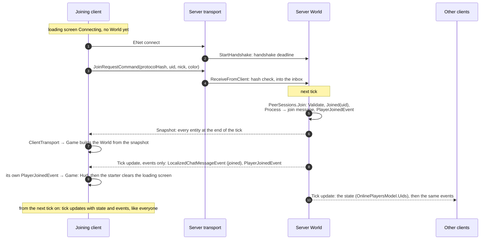

# Networking

[← Project README](../README.md)

ENet carries raw bytes; there is no RPC, no `MultiplayerSpawner` and no `MultiplayerSynchronizer`. The server runs
the game, a client only applies what the server sends and sends commands back. The services named here live in the
World; their layers and the World itself are in [World](World.md).

## Transport and roles

* **`Network`** ([Scenes/Game/Networks/Network.cs](../Src/NeonWarfare/Scenes/Game/Networks/Network.cs)) — ENet
  only: `HostServer()`, `OpenServer()`, `ConnectToServer()`, `Send(peerId, bytes)`, `Disconnect(peerId)` and the
  connection events. It creates a fresh `SceneMultiplayer` per `Game`, so no handler outlives the session, and
  unsets it on `Game.TreeExiting`. A server is hosted with `RefuseNewConnections` and opened only after its World
  is built.
* **The transports** ([Scenes/Game/Networks/Transport/](../Src/NeonWarfare/Scenes/Game/Networks/Transport/)) — plain
  objects implementing `IClientsConnection` (server → clients) and `IServerConnection` (client → server), created by
  `Game` with their World. `ServerTransport` routes the remote peers of a server into `World.IServerEndpoint`;
  `HostTransport` loops the host's own peer back into `World.IServerEndpoint` and `World.IHostEndpoint` and hands
  the others to its `ServerTransport`;
  `ClientTransport` is a remote client's connection: it has no World until the join snapshot, then routes into
  `World.IClientEndpoint`. The World hands `IClientsConnection` the tick and the sections, never a packet. The direction
  a configuration does not use is `NoConnection`. `GameProtocol` holds what the client needs before its World exists:
  `EntityCatalog`, `NetMessageCodec`, the `ProtocolHash` and the RepliCAT `Replicator`.
* **The host is an ordinary peer.** Its own peer is peer 1 (the server's id): a packet for it never reaches ENet,
  `HostTransport` hands it to its own World synchronously, inside the call. So the host's commands pass the same
  decoding and whitelist as a remote client's, and its event handlers run in the physics step, before `_Process`.
  Single player is a host without `Network`.

A process has no role. What runs is decided by the set of layers the starter builds the World from
(see [World](World.md#layers)): no code asks "am I the server".

## The server tick

`WorldTickNode` (`ProcessPhysicsPriority = int.MaxValue`, with the Simulation) calls
`ServerTickLoop.RunTick()` last in every physics step, so the physics callbacks and every other `_PhysicsProcess`
belong to the tick. `RunTick` goes strictly in this order:

1. `ServerTickClock.StartTick()` — the tick counter, read by every layer through `IWorldClock`;
2. `CommandDispatcher.ProcessAll()` — every command and disconnection received since the last tick;
3. `PeerGatekeeper.DisconnectExpired()` — peers that have not joined in `HandshakeTimeout` (10 s);
4. `ITickingFacade.Tick()` of every ticking facade, each one its own fault boundary;
5. the state section of the tick (`StateReplicator.TryWrite`), written every tick;
6. the snapshots to the peers joined in this tick;
7. the saves requested in this tick (`SaveService.WriteRequested`, see [Data and saves](Data-and-saves.md));
8. the tick update of each joined peer, sent even if step 6 or 7 throws: the baselines have already moved.

The Simulation changes the models only inside the tick: it has no deferred calls, timers or `async`
(`SimulationTimingTests`). A time rule is the `Tick()` of a ticking facade, a `[SimulationFacade]` with no state of
its own (`TickingFacadeTests`), independent of the order of the other ticking facades.

## The client tick

A remote client counts the server tick in `ClientTickClock`, read through `IWorldClock`. The World root syncs it from
the snapshot's tick before the snapshot is applied, and from every tick update before its sections, so an event
handler sees at least the tick of its packet. Between the packets its own `WorldTickNode` advances it by one, last in
every physics step, as on the server.

The clock never goes back. A tick ahead of it moves it there at once. A tick behind it means the client has counted
ahead, so the clock skips as many next advances as it is ahead of that latest packet and converges back to the server.
A frame that drops physics steps leaves it behind until the next packet. The host has no such clock: its Presentation
reads the `ServerTickClock` its server advances.

## Commands: client → server

A command is a `Command` record with MessagePack keys. The HUD sends it through `World.ICommandSender` →
`PlayerCommandSender`, the only sender in the World; `JoinRequestCommand` alone is sent by the transport: the
host's by `Game.AddSingleplayerWorld` / `Game.AddHostWorld`, a remote client's on connecting, before it has a World.
A command is sent at once, not at the tick.

On the server `CommandInbox` decodes a packet on arrival, against the whitelist `CommandHandlerRegistry` builds from
the found handlers: a type without a network handler, a broken body or trailing bytes is logged as `WARN` and
dropped. A `JoinRequestCommand` with another protocol hash is rejected right here (`Disconnecting` + disconnect).
The rest waits in the inbox together with the `PeerDisconnected` entries, one order per peer.

`CommandDispatcher` drains the inbox in the tick: a join goes to `PeerSessions`, a disconnection too, and any other
command — only from a joined peer — to its `IPlayerCommandHandler<T>`, which gets the sender's uid, never the peer:
`Validate`, then `Process`. A throwing entry is logged and costs only itself.

## Packets: server → client

The first byte of every packet is its `ServerPacketKind`; the layout is written and read only by `ServerPackets`
(`Game/Networks/Transport/`), and the World sees only the tick and the sections:

| Kind | Content | To whom |
|---|---|---|
| `Snapshot` | The tick, then a spawn record of every entity (`StateReplicator.WriteSnapshot`) | A peer that joined in this tick, except the host's own |
| `TickUpdate` | The tick, the state section's length, the state section — spawns → models → despawns (`StateReplicator.TryWrite`), then the events section (`EventOutbox.DrainEvents`) | Every joined peer with a non-empty section; the state only to the peers joined before this tick, except the host's own |
| `Disconnecting` | One `DisconnectReason` byte, frozen across builds | A peer the server cuts off with a reason, just before the disconnect |

The state section is the same for everyone and written once. An empty section is absent, and a tick update with
neither is not sent. The state section comes before the events section, so an event handler sees the models already
at the end of the tick, on the host and on a remote client alike.
ENet delivers a fragmented reliable packet whole, so a client applies a tick atomically.

A send that fails (`IClientsConnection` returns `false`) disconnects the peer with `MissedPacket`: it has missed a
reliable packet.

A client applies a packet at once, in `peer_packet`, with no queue: `ClientTransport` routes a tick update to
`World.IClientEndpoint.ReceiveTickUpdate`, which applies the state section (`StateApplier`), then dispatches the
events section (`EventDispatcher`). The host gets only its events, through `World.IHostEndpoint.ReceiveOwnEvents`: its
Simulation has already written the state.
A packet the client cannot read or apply ends its session (`ClientTransport.ConnectionBroken` → `Game.Failed`): it may
be applied in part while the server's baselines have moved on, so the models would drift; a new join brings a fresh
snapshot.
`Disconnecting` never reaches a World: the transport reads it, with or without a World, and calls
`ILocalPlayerOwner.Disconnected`; `Game` reports it as `Failed`, and the starter leaves for the menu with the reason,
on a remote client and on a host refused its own join alike.

Events are published only by the Simulation, into `EventOutbox` (`PublishToAll` / `PublishTo(uid)`), one buffer per
joined peer, so personal and common events keep the order of publication. An event is encoded when published, so
an event that cannot be serialized fails in single player too. On the client it reaches the `[EventHandler]`
methods of the Presentation (see [World](World.md)). An event is self-sufficient: a model can be ahead of it, since a
packet carries only the last value of a tick.

## Join and leave

The state of every peer lives in `PeerStateTable`: `Connecting(deadline)` → `Joined(uid)` with its event
buffer. The server cuts a joined peer off as `Leaving(uid)`, whose uid stays taken until its `peer_disconnected`
unless displacement frees it at once; any other cut-off peer is `TurnedAway`. Only a `Connecting` peer may join, and
only a `Joined` one gets packets and has its commands handled.

`peer_connected` only starts the handshake deadline in `PeerGatekeeper`, which cuts the peer off with
`HandshakeTimeout`. The peer joins by sending
`JoinRequestCommand(protocolHash, uid, nick, color)`; until then it receives nothing. In the tick, `PeerSessions`:

* drops a second join of a joined peer;
* asks `IPeerSessionHandler.ValidateJoin` — a refusal sends `Disconnecting(reason)` and disconnects the peer;
* displaces a peer already online with the same uid: the old one gets `Disconnecting(Displaced)`, is disconnected
  and leaves with `LeaveReason.Displaced`, then the new one joins (a crashed client comes back without waiting for
  ENet to notice).
  A displaced admin has not left, so `IServerOwner.AdminLeft` is not called. The uid of the `ProtectedPlayer` port —
  the host's own player, the admin of a child server — cannot be taken, `UidInUse`: its owner cannot reconnect
  without leaving the server;
* marks the peer `Joined` and calls `IPeerSessionHandler.Join`, which joins the player through the Simulation.

`peer_disconnected` enqueues `PeerDisconnected`; in the tick the peer leaves the table and
`IPeerSessionHandler.Leave(uid, LeaveReason.Disconnected)` runs for a `Joined` or `Leaving` one. Between a
server-side disconnect and its `peer_disconnected` every command of the peer is dropped.

The joined peer does not get the state section of its join tick: the snapshot already is the state at its end. The
snapshot is written right after the state section, from the baselines that section has just brought to the end of
the tick, so "snapshot, then the next state section" is consistent. The chat history is not in it.

## Entities and replication

* **`NetId`** — the network identity of an entity, the same on the server and every client: a monotonic `long` from
  `NetIdGenerator`, never reused, `NetId.None` for "nothing" and for the World root as a parent.
* **`EntityRegistry`** — NetId ↔ node ↔ kind of every spawned entity, read by every layer through `IEntityFinder`
  (`GetSingle<T>`, `GetAll<T>`, `Spawned`, `Despawned`). A node leaves it on `TreeExiting`, its subtree
  with it.
* **`EntityCatalog`** — the kind id of every entity: the scenes of `WorldPackedScenes` by resource path, then every
  concrete `Node` type of the type mapping with a parameterless constructor. The id travels in spawn records and lies
  in saves, so the catalog is part of the protocol hash.
* **Spawn on the server** — only `EntitySpawner.Spawn<T>(scene | type, parent, initPreReady)`: the node is created
  and set up before it enters the tree, then gets a NetId, its place and the registry. `Despawn` removes the
  subtree.
* **Replication** — `StateReplicator` subscribes to the registry and keeps a RepliCAT baseline per entity; at the end
  of the tick it writes the spawn records (NetId, kind, parent, first delta), the deltas of changed models and the
  despawns. The models are captured there, not at spawn.
* **On a remote client** — `StateApplier` applies the state section of a tick update and the join snapshot;
  `EntityRecordReader` spawns from the records with their NetIds (the same reader loads a save on the server).

## Transfer channels

`Consts.TransferChannel`, passed to `Network.Send`. The rows are in declaration order — the position of a channel
is its number.

| Channel | What goes through it |
|---|---|
| `Default` | Godot's channel 0, reliable and ordered: every packet of both directions |

## Payload

Commands and events — MessagePack, behind a 2-byte type id from `TypesMappingService` (`NetMessageCodec`); the
codec reads untrusted data and only the types it is given. Models, snapshots and saves — RepliCAT. A custom wire type
(`PlayerUid`, `NetId`, `TickTimer`) gets its formatter and its codec in `ProtocolCodecs`. The protocol hash
in `JoinRequestCommand` and in the save header covers the mapped types, their MessagePack keys, the RepliCAT schemas
and the entity kinds (`ProtocolHasher`, computed once by `GameProtocol`), so a peer or a save of another build is
refused instead of read as garbage.
